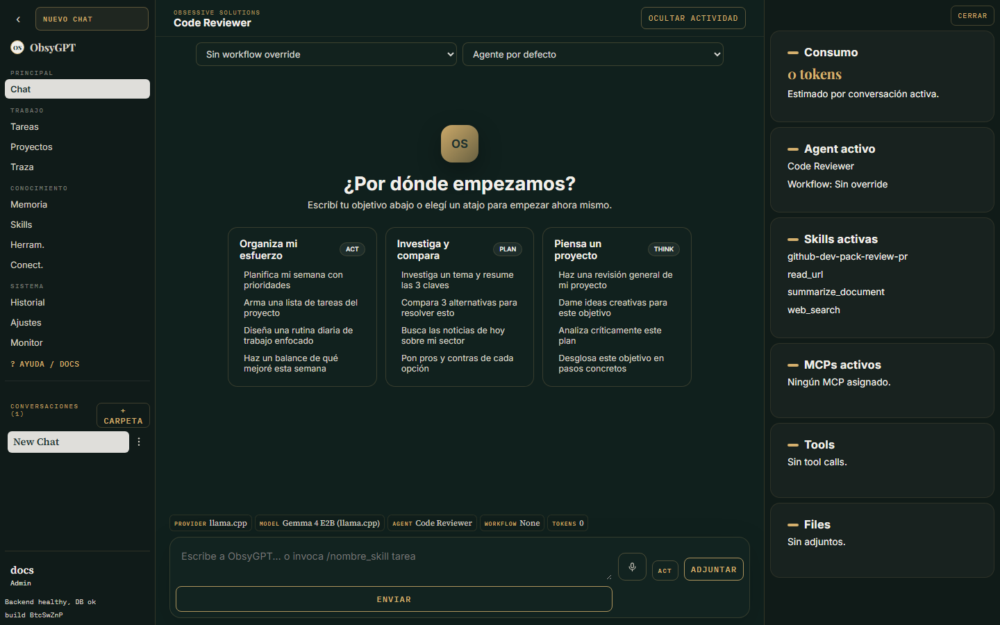
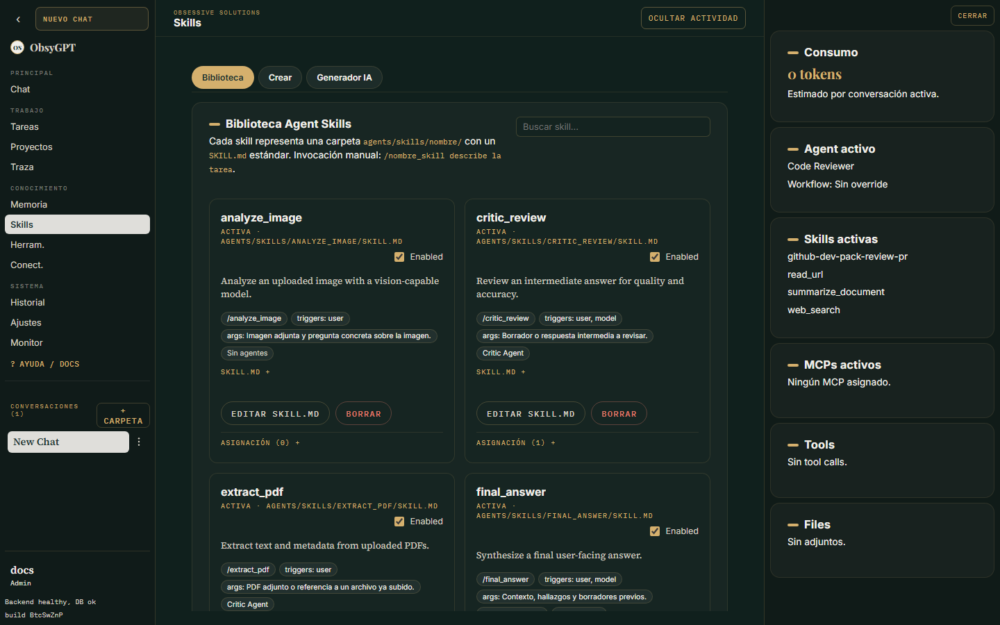
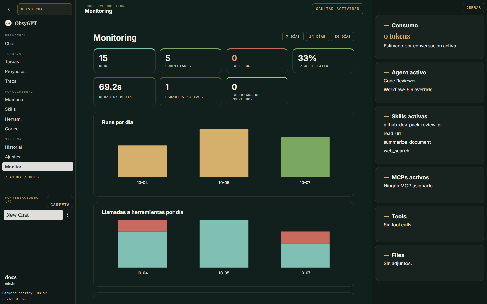

<div align="center">


[](https://github.com/JJRProDigital/ObsyGPT/actions/workflows/ci.yml)
[](LICENSE)


**La IA propone. Tú apruebas.**
Un workspace de agentes IA que corre en tu propia infraestructura: chat agéntico con herramientas reales, voz, Telegram, triggers proactivos, sub-agentes y trazabilidad total.

[Documentación](/docs/) · [Inicio rápido](#-inicio-rápido) · [Características](#-qué-incluye) · [Seguridad](#-seguridad) · [API](#-api-openai-compatible) · [Licencia](#-licencia)

</div>

---

## 📸 La app, no un mockup

| Chat agéntico | Skills |
| --- | --- |
|  |  |
| **Tareas en segundo plano** | **Monitorización** |
|  |  |

## ✨ Qué incluye

- **Chat agéntico** — bucle iterativo plan → actuar → observar con un protocolo de herramientas en texto plano que funciona con cualquier modelo (OpenRouter, OpenAI, Anthropic, Gemini, Ollama, llama.cpp o cualquier endpoint compatible con OpenAI), incluidos modelos locales.
- **Aprobaciones de acciones sensibles** — escrituras de archivos, comandos de shell y despacho de sub-agentes pausan el flujo hasta que apruebas o rechazas desde la UI; el bucle se reanuda exactamente donde se detuvo.
- **Sub-agentes** — la tool `dispatch_subagents` delega hasta 3 líneas de trabajo paralelas a otros agentes configurados; los runs hijos quedan enlazados al padre en la vista de traza.
- **Estándar Agent Skills** — las skills viven en `agents/skills/<nombre>/SKILL.md`, editables desde la UI e invocables desde el chat con `/nombre_skill tarea`.
- **MCP** — registra servidores MCP (comando o URL), inspección con handshake real `initialize`/`tools/list` y exposición a los agentes como tools con aprobación.
- **Conectores** — credenciales cifradas por usuario; incluidos: GitHub (repos, archivos, issues), Google Drive (solo lectura) y Higgsfield (OAuth, generación de imágenes y video).
- **Generación de imágenes** — Google Flow (Nano Banana Pro / 2 / 2 Lite) con tu cuenta de Google vía MCP containerizado, y Higgsfield (imágenes y video) vía conector OAuth o API. Referencias con `@{nombre}`, edición de imágenes generadas y resultado embebido en el chat (clic para ver en grande).
- **Plugins** — paquetes compartibles (`plugin.json`) con skills, MCPs y sub-agentes; desde catálogo local o marketplaces git.
- **Proyectos y tareas** — contexto por proyecto; tareas en segundo plano con programación, recurrencia, pausa/reanudación y auto-recuperación.
- **Telegram** — un bot por agente: tareas autónomas desde el chat, notas de voz en ambas direcciones y aprobaciones con botones inline.
- **Triggers proactivos** — intervalos, vigilancia de cambios (URL/RSS), webhooks con secreto y `schedule_trigger` para que el agente se agende solo (modo lectura por defecto).
- **Voz en el chat** — push-to-talk con transcripción local (faster-whisper) y respuestas habladas (Piper, voz en español).
- **Memoria semántica** — recuerdos e historial indexados con embeddings locales (pgvector) y recuperación automática + tool `memory_search`.
- **API keys de proveedores en el panel** — pega la clave de tu LLM en Ajustes > Modelo > Proveedores: se guarda cifrada (Fernet) y nunca vuelve a mostrarse. Alternativa por variable de entorno.
- **Endpoint OpenAI-compatible** — expón tus agentes como modelos ante IDEs, n8n o LibreChat con `/v1/chat/completions` y `/v1/models`.
- **Monitorización** — panel de administración (runs/día, tools, duraciones, fallbacks) y exportación OTLP opcional.
- **Todo trazado** — cada run, tool call, llamada MCP y aprobación queda registrado e inspeccionable.

## 🚀 Inicio rápido

```bash
git clone https://github.com/JJRProDigital/ObsyGPT
cd ObsyGPT
cp .env.example .env    # pega tu API key
docker compose up -d
```

Abre `http://localhost:3001/app/` y crea **la primera cuenta de la instancia** (queda como administrador). A partir de ahí, solo los admins dan de alta usuarios desde **Ajustes > Administración > Usuarios**.

| Variable | Obligatoria | Descripción |
|---|---|---|
| `POSTGRES_PASSWORD` | recomendada | Contraseña del servicio Postgres |
| `OPENROUTER_API_KEY` | un proveedor | Key del proveedor por defecto sembrado |
| `SESSION_SECRET` | sí | Cadena aleatoria que firma las sesiones |
| `FRONTEND_URL` | por defecto vale | Origen público del frontend (CORS) |

<details>
<summary><strong>🔧 Desarrollo local</strong></summary>

```bash
docker compose up -d postgres

# Backend
cd backend
python -m venv .venv && .venv\Scripts\activate     # Windows
pip install -r requirements.txt
cp .env.example .env                               # DATABASE_URL apunta a localhost
alembic upgrade head
uvicorn app.main:app --reload --host 127.0.0.1 --port 8000

# Frontend (otra terminal)
cd frontend-modern
npm install
npm run dev                                         # http://127.0.0.1:5173/app/
```

Tests: `cd backend && python -m pytest -q` · Build frontend: `cd frontend-modern && npm run build`.
Navegador: `pip install playwright && playwright install chromium`.

</details>

<details>
<summary><strong>🦙 Modelos locales (llama.cpp / Ollama)</strong></summary>

Con el quickstart Docker, `127.0.0.1` dentro del contenedor no es tu máquina:

1. Arranca el servidor en todas las interfaces (`llama-server --host 0.0.0.0 --port 8080` o `OLLAMA_HOST=0.0.0.0`).
2. **Ajustes > Modelo > Proveedores**: registra el proveedor con `http://host.docker.internal:8080/v1` (llama.cpp) o `http://host.docker.internal:11434/v1` (Ollama).
3. **Detectar modelos** y activa el que quieras.

En desarrollo local usa las URLs normales (`http://127.0.0.1:8080/v1`, etc.).

</details>

<details>
<summary><strong>📖 Documentación completa</strong></summary>

Manual de usuario con capturas servido desde el **mismo contenedor** del frontend en `/docs/` (Material for MkDocs, en `docs/`) — nada extra que desplegar. Para editar en caliente:

```bash
docker compose -f docker/docker-compose.docs.yml up   # http://localhost:8010 (solo desarrollo)
```

Capturas: `cd scripts/docs-screenshots && npm install && npx playwright install chromium`, luego `DOCS_PASSWORD=xxx node shoot.mjs` contra una instancia local.

</details>

## 🔒 Seguridad

- **Aprobación humana** para toda acción sensible; **modo lectura** para los runs proactivos.
- Tool de shell **acotada al workspace**, con entorno mínimo (sin secretos del proceso) y allowlist por segmento (`AGENT_COMMAND_ALLOWLIST`).
- **Mitigación SSRF**: `web_fetch`, `read_url` y navegador rechazan localhost, IPs privadas y hosts internos.
- **Secretos cifrados en reposo** (Fernet): claves de proveedores, credenciales de conectores y tokens de Telegram.
- **Telegram**: allowlist por bot; mensajes de desconocidos ignorados en silencio.
- Cambia `POSTGRES_PASSWORD` y `SESSION_SECRET` antes de exponer la app; usa `OBSYGPT_REQUIRE_STRONG_SECRETS=1` en producción.

## 🤖 API OpenAI-compatible

```bash
# 1) Genera una clave en Ajustes > Seguridad > Claves de API (se muestra una vez)
# 2) Lista tus agentes como modelos:
curl -H "Authorization: Bearer ogpt-..." http://localhost:3001/v1/models
# 3) Conversa con un agente (por nombre o agent-{id}):
curl -H "Authorization: Bearer ogpt-..." -H "Content-Type: application/json" \
  -d '{"model": "Code Reviewer", "messages": [{"role": "user", "content": "Hola"}]}' \
  http://localhost:3001/v1/chat/completions
```

Stateless, con streaming SSE (`"stream": true`), trazado y solo tools seguras.

<details>
<summary><strong>💬 Telegram y triggers en 3 pasos</strong></summary>

**Telegram**: bot con [@BotFather](https://t.me/BotFather) → tu ID con `@userinfobot` → Ajustes > Agentes > Telegram: token + allowlist `<telegram_id>:<usuario>` + **Probar token** + activar.

**Triggers** (Ajustes > Triggers): intervalo fijo, vigilancia de cambio (URL/RSS) o webhook con `X-Trigger-Secret`. Cooldown anti-ruido, aviso por Telegram y auto-agendación con `schedule_trigger` (máx. 10 activos por usuario).

</details>

## 🗂️ Estructura

```text
backend/            App FastAPI: bucle de agente, tools, skills, MCP, conectores, plugins, tareas, triggers, Telegram, voz, monitorización
frontend-modern/    UI React + TypeScript + Vite (src/views por pantalla)
  landing/          Landing del panel (solo deploy privado)
agents/skills/      Agent Skills (estándar SKILL.md)
plugins/            Catálogo local de plugins
services/flow-mcp/  MCP opcional de generación de imágenes (Google Flow / Nano Banana), containerizado
docs/               Documentación de usuario (Material for MkDocs)
database/schema.sql Esquema PostgreSQL (las migraciones Alembic son la fuente de verdad)
```

<details>
<summary><strong>🍌 Generación de imágenes con Google Flow (opcional)</strong></summary>

Genera imágenes con Nano Banana (Pro / 2 / 2 Lite) usando tu cuenta de Google Flow, sin API keys: el servicio corre un Chromium headed en contenedor, automatiza [flow.google.com](https://flow.google.com) y lo expone como MCP de tipo URL. Código vendido de [srz-google-flow-mcp](https://srzclub.com/flow-mcp) (MIT) en `services/flow-mcp/`.

```bash
# 1) Activa el profile y configura la URL del MCP en .env
echo "FLOW_MCP_URL=http://flow-mcp:8808" >> .env
echo "MCP_TOOL_TIMEOUT=180" >> .env
docker compose --profile flow up -d --build

# 2) Una sola vez: abre http://localhost:6901 y inicia sesión con tu cuenta de Google
#    (el perfil queda persistido en el volumen obsygpt_flow_profile)

# 3) En la app: Ajustes > Agentes > asigna el MCP "Google Flow" a tu agente
```

El backend siembra el MCP `Google Flow` solo al arrancar (si `FLOW_MCP_URL` está definida). Las imágenes se guardan en `data/flow-images/` del host; para fotos de referencia, el agente puede subir archivos de `data/flow-uploads/` o del workspace (`/data/workspace`) con `flow_upload_file` y referenciarlos como `@{nombre}` en el prompt.

**Recomendaciones de modelo y seguridad** (aprendidas a fuego):

- Usá un modelo **estable y agéntico** para las tareas de Flow: los pools de modelos gratis cambian de modelo por request y flubean nombres de herramientas. En omniroute funcionan verificados: `auto/fast`, `auto/best-chat`, `auto/smart`.
- Las tools de Flow son `sensitive`: piden aprobación por llamada. Para cadenas largas (upload → generate), ponelas en `allow` en **Ajustes > Seguridad** (por usuario).
- Si tu proxy enruta requests con imágenes a un tier de visión, y ese tier está roto, los chats con adjuntos van a fallar con 400 aunque el pool general esté sano: desactivá `supports_vision` del modelo en **Ajustes > Modelos** (el agente pasa el archivo a Flow igual, no necesita "ver" la imagen).

**Avisos**: automatización no oficial de la web de Flow (si Google cambia la UI, puede romperse); el consumo de imágenes depende de tu plan de Flow; solo actívalo en instancias de confianza — el Chromium del contenedor queda autenticado con tu cuenta de Google.

</details>

<details>
<summary><strong>🎨 Generación de imágenes y video con Higgsfield (opcional)</strong></summary>

Conector integrado con OAuth: al conectarlo desde **Ajustes > Conectores** se abre Higgsfield para autorizar el acceso y el token se renueva solo. Expone tres tools a los agentes:

- `higgsfield_api_generate_image` — genera imágenes con los modelos de Higgsfield (resultado servido en URL de CloudFront).
- `higgsfield_api_generate_video` + `higgsfield_api_request_status` — video generativo con sondeo de estado.
- `higgsfield_mcp_call` — acceso directo al servidor MCP de Higgsfield para capacidades adicionales.

El agente combina Higgsfield con las tools de archivos: puede descargar el resultado al workspace, editar una imagen generada (subirla como referencia `@{nombre}` y regenerar) y embeber el resultado en el chat igual que con Google Flow.

**Aviso**: el consumo depende de los créditos de tu cuenta de Higgsfield.

</details>

<div align="center">

**Obsessive Solutions** · MIT — ver [LICENSE](LICENSE)

</div>
