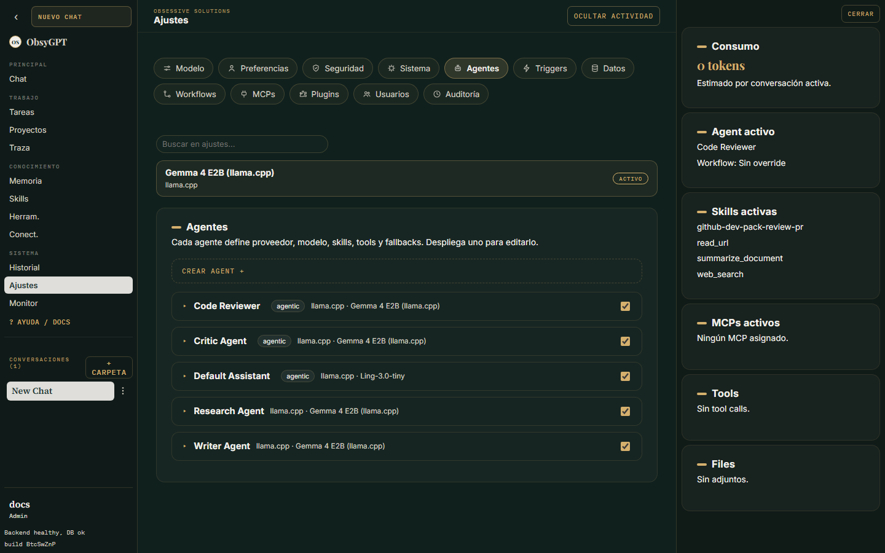

Trabajar

# Agentes

Un **agente** es la unidad de trabajo de ObsyGPT: combina un modelo, un system prompt, un conjunto de tools, skills, servidores MCP, conectores y su propia memoria. Puedes crear tantos como quieras y cambiar entre ellos desde el selector del chat.

## Crear un agente

Ve a **Ajustes > Agentes > Crear agente** y define:

| Campo | Qué hace |
|---|---|
| Nombre | Con qué lo identificarás (y con qué lo llamas por la API) |
| System prompt | Personalidad, tono y reglas del agente |
| Proveedor / modelo | Override del modelo activo, o hereda el global |
| Temperature | Creatividad de las respuestas |
| Internet | Habilita las tools web (búsqueda, lectura de URLs, navegador) |
| Multimodal | Acepta imágenes y adjuntos multimodales |
| Modo agéntico | Permite bucles largos de plan → actuar → observar |

## Tools por agente

Cada agente puede habilitar o deshabilitar tools concretamente (Ajustes > Agentes > Herramientas). Las tools sensibles requieren [aprobación](herramientas.md) salvo que les des permiso explícito.

## Skills por agente

Activa las skills de la biblioteca que ese agente debe conocer. Ver [Skills](skills.md).

## MCP por agente

Conecta servidores MCP registrados y sus herramientas aparecerán como tools del agente. Ver [MCP](mcp.md).

## Fallbacks

Define una cadena de proveedor/modelo de respaldo por prioridad: si el modelo principal falla, ObsyGPT reintenta con el siguiente automáticamente. Los fallbacks se muestran en [Monitorización](monitoreo.md).

## Telegram por agente

Cada agente puede tener **su propio bot de Telegram** con token propio y allowlist de usuarios. Ver [Telegram](telegram.md).

## Triggers por agente

Los triggers proactivos apuntan siempre a un agente concreto. Ver [Triggers](triggers.md).
