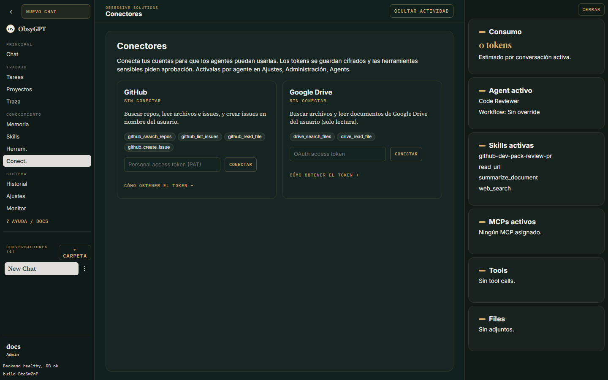

Extender

# Conectores

Los **conectores** son integraciones con servicios externos cuyas credenciales se **cifran en reposo por usuario** (y no se vuelven a mostrar tras guardarlas). Configúralos en la vista **Conectores**.

## Conectores incluidos

| Conector | Capacidades |
|---|---|
| **GitHub** | Buscar repos, leer archivos, listar y crear issues |
| **Google Drive** | Lectura de archivos y búsqueda |

## Cómo funcionan

1. Añades la credencial (token OAuth o PAT) en la vista Conectores.
2. Se cifra con la clave Fernet (`CONNECTOR_ENCRYPTION_KEY`, derivada de `SESSION_SECRET` si no la defines).
3. Las tools del conector aparecen para los agentes con acceso a conectores y respetan las políticas de permisos.

## Seguridad

- Las credenciales **nunca se devuelven** por la API después de guardarlas.
- Cada usuario conecta sus propias credenciales — no hay credenciales compartidas entre cuentas.
- Los usos quedan trazados como cualquier otra tool.

Ver [Seguridad](seguridad.md) para la configuración de claves de cifrado.
