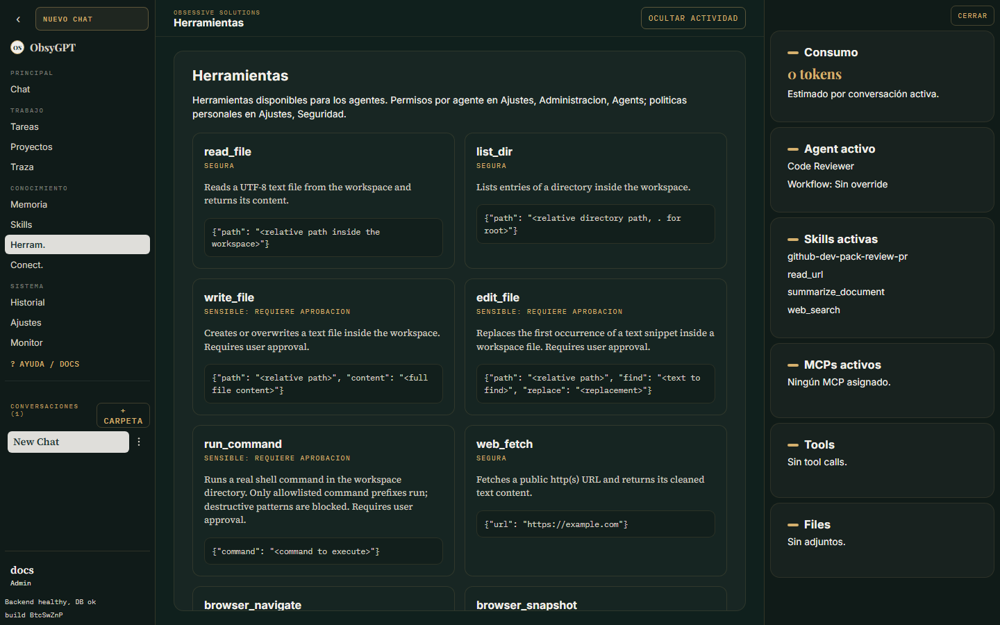

<p class="os-kicker" markdown>Trabajar</p>
# Herramientas y aprobaciones

Las **tools** son las capacidades ejecutables del agente. Cada una pertenece a una de dos categorías:

- **Seguras** — solo lectura o efecto reversible (buscar web, leer URLs, buscar memoria). Se ejecutan sin fricción.
- **Sensibles** — escriben archivos, ejecutan comandos de shell o despachan sub-agentes. Requieren **aprobación humana** salvo política explícita.

## Catálogo

La vista **Herramientas** muestra todas las tools disponibles, su categoría y qué agentes las tienen activas.



## Políticas por herramienta

En **Ajustes > Seguridad > Permisos** eliges por herramienta: *permitir*, *preguntar* (aprobación) o *bloquear*. Es la forma rápida de aflojar o endurecer el comportamiento de un agente sin tocar su prompt.

## Tool de shell

La tool de terminal está **acotada al workspace** y protegida por tres capas:

1. Solo se ejecuta dentro de la carpeta del espacio de trabajo.
2. Hereda un entorno mínimo (sin API keys ni secretos del proceso) — usa `AGENT_COMMAND_ENV_PASSTHROUGH` si un comando necesita variables concretas.
3. Cada segmento de comandos encadenados se valida contra la allowlist `AGENT_COMMAND_ALLOWLIST`.

## Herramientas de navegador

`browser_navigate` y companyía requieren **Playwright** (no incluido en la imagen Docker). En desarrollo local:

```bash
pip install playwright
playwright install chromium
```

Todas las tools de red (web_fetch, read_url y navegador) rechazan URLs hacia localhost, IPs privadas y hosts que resuelvan a direcciones internas — mitigación SSRF. Ver [Seguridad](seguridad.md).

## Límites de ejecución

En **Ajustes > Seguridad > Límites** ajustas los guardrails del bucle agéntico:

| Límite | Qué controla |
|---|---|
| Iteraciones máximas | Pasos del bucle por run |
| Tool calls máximas | Llamadas a herramientas por run |
| Duración máxima | Tiempo total del run |
| Caracteres de salida por tool | Truncado de resultados individuales |
| Caracteres totales | Presupuesto de contexto del run |
| Detección de bucles | Rechazo de repeticiones idénticas |
