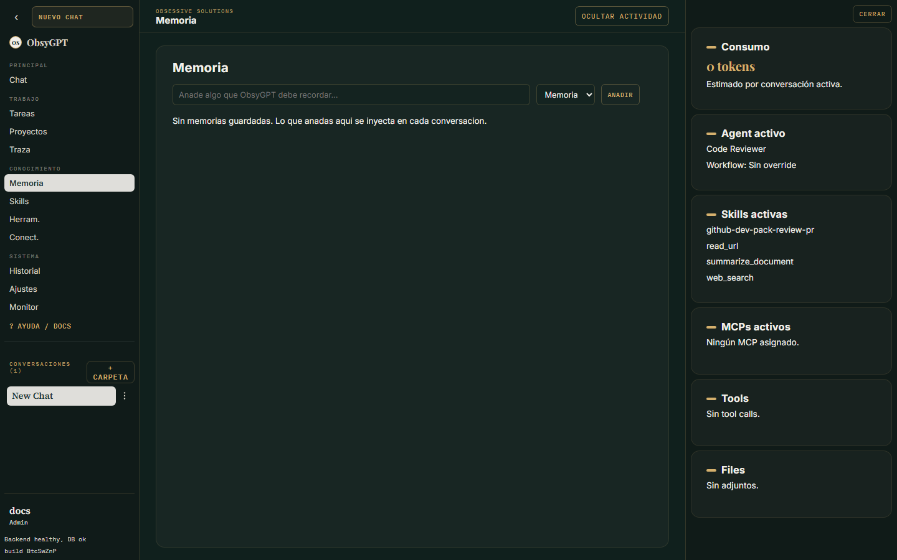

Trabajar

# Memoria

ObsyGPT tiene dos capas de memoria que trabajan juntas para que tus agentes recuerden lo importante.

## Memoria de usuario

Recuerdos explícitos por usuario que se **inyectan en cada chat** (con un límite configurable). Gestiónalos en la vista **Memoria**: añade, edita o borra recuerdos y revisa los **hábitos aprendidos** — patrones de uso que el sistema sugiere a partir de tu historial.

## Memoria semántica (pgvector)

Recuerdos y conversaciones pasadas se indexan con **embeddings** en Postgres (pgvector):

- Al chatear, los agentes recuperan automáticamente el contexto relevante.
- Con la tool `memory_search` pueden buscar a fondo en el historial.

## Embeddings

En **Ajustes > Modelo > Embeddings** eliges cómo generar los vectores:

| Modo | Descripción |
|---|---|
| `local` | Modelo local (fastembed), sin salidas de red — por defecto |
| `endpoint` | Cualquier endpoint compatible con OpenAI (`/embeddings`) |

La caché del modelo local vive en `FASTEMBED_CACHE_PATH` (en Docker se monta en el volumen de voz).

## Límites y reseteo

- En **Ajustes > Sistema > Memoria** ajusta cuántos recuerdos se inyectan por mensaje.
- En **Ajustes > Datos** puedes resetear los hábitos aprendidos y limpiar recuerdos.
