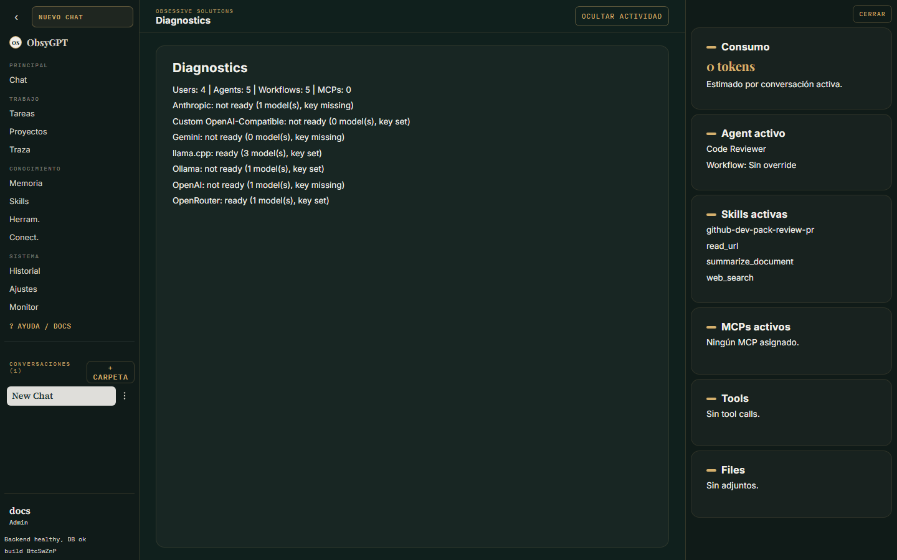

<p class="os-kicker" markdown>Operación</p>
# Monitorización

Panel de administración con la salud operativa de tu instancia: solo visible para admins.


## Qué mide

| Métrica | Descripción |
|---|---|
| Runs/día | Actividad agéntica agregada por día |
| Uso de tools | Qué herramientas se llaman y con qué frecuencia |
| Duraciones | Tiempo de ejecución por run |
| Fallbacks | Cuántas veces se activó la cadena de respaldo de modelos |

Rango configurable (por defecto 14 días).

## Diagnóstico

La vista **Diagnóstico** resume el estado del sistema: salud de servicios, configuración efectiva y problemas detectables.



## Exportación OTLP

Para mandar los eventos a tu stack de observabilidad (Grafana, Honeycomb...):

```env
OTEL_EXPORTER_OTLP_ENDPOINT=https://tu-colector:4317
OTEL_EXPORTER_OTLP_HEADERS=Authorization=Bearer xxx
OTEL_CONTENT_CAPTURE=none
```

Eventos emitidos: `user_prompt`, `assistant_response`, `tool_result`, `api_error`. El **contenido va redactado por defecto** — controla el nivel de captura con `OTEL_CONTENT_CAPTURE`.
