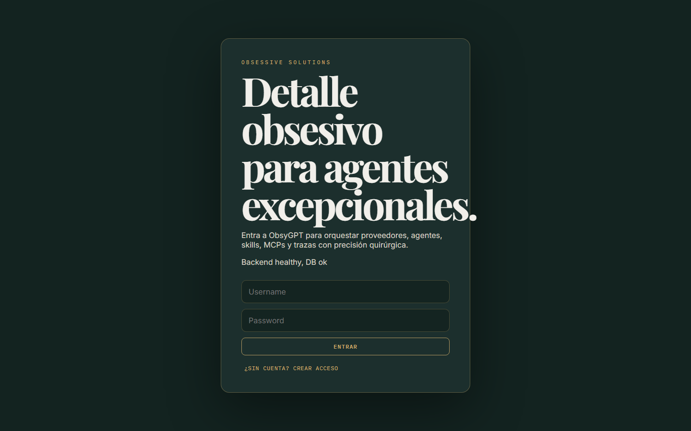
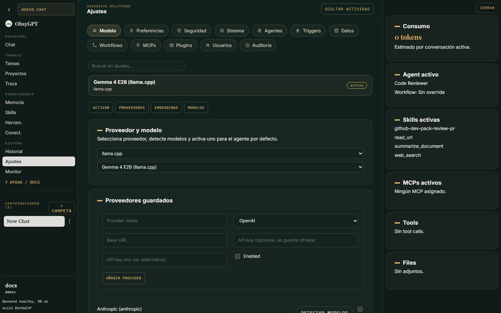

<p class="os-kicker" markdown>Empezar</p>
# Primeros pasos

ObsyGPT es un workspace de agentes IA que corre **en tu propia infraestructura**: chateas con agentes configurables, los controlas desde Telegram, los dejas trabajar de forma proactiva con triggers y los extiendes con skills, servidores MCP, plugins y conectores — siempre con aprobación humana para cada acción sensible.

## Qué incluye

- **Chat agéntico** con bucle iterativo plan → actuar → observar, compatible con cualquier modelo (OpenRouter, OpenAI, Anthropic, Gemini, Ollama, llama.cpp o cualquier endpoint compatible con OpenAI).
- **Aprobaciones de acciones sensibles**: escrituras de archivos, comandos de shell y despacho de sub-agentes pausan el flujo hasta que apruebas o rechazas desde la UI.
- **Sub-agentes**: delega hasta 3 líneas de trabajo paralelas con `dispatch_subagents`.
- **Agent Skills estándar** (`SKILL.md`), servidores **MCP**, **plugins** compartibles y **conectores** (GitHub, Google Drive).
- **Proyectos y tareas** en segundo plano con programación, recurrencia y auto-recuperación.
- **Telegram**, **triggers proactivos**, **voz** (Whisper + Piper, todo local) y **memoria semántica** con pgvector.
- **Endpoint compatible con OpenAI** (`/v1/chat/completions`) para usar tus agentes desde IDEs, n8n o LibreChat.
- **Monitorización** con panel de administración y exportación OTLP opcional.

## Requisitos

- **Docker** (quickstart todo-en-uno) — recomendado.
- Alternativa de desarrollo local: Python 3.13 + Node 20 + PostgreSQL 16.

## Instalación con Docker

=== "Quickstart"

    ```bash
    git clone https://github.com/JJRProDigital/ObsyGPT
    cd ObsyGPT
    cp .env.example .env    # pega tu API key
    docker compose up -d
    ```

=== "Desarrollo local"

    ```bash
    docker compose up -d postgres

    # Backend
    cd backend
    python -m venv .venv && .venv/Scripts/activate     # Windows
    pip install -r requirements.txt
    cp .env.example .env
    alembic upgrade head
    uvicorn app.main:app --reload --host 127.0.0.1 --port 8000

    # Frontend (otra terminal)
    cd frontend-modern
    npm install
    npm run dev    # http://127.0.0.1:5173
    ```

## Variables de entorno mínimas

| Variable | Obligatoria | Descripción |
|---|---|---|
| `POSTGRES_PASSWORD` | recomendada | Contraseña del servicio Postgres (por defecto `obsygpt_dev_password`) |
| `OPENROUTER_API_KEY` | un proveedor | Key del proveedor por defecto sembrado |
| `SESSION_SECRET` | sí | Cadena aleatoria que firma las sesiones |
| `FRONTEND_URL` | por defecto vale | Origen público del frontend (CORS) |

Genera una sesión segura con:

```bash
python -c "import secrets; print(secrets.token_urlsafe())"
```

!!! warning "Producción"
    Cambia `POSTGRES_PASSWORD` y `SESSION_SECRET` antes de exponer la app. En producción usa `OBSYGPT_REQUIRE_STRONG_SECRETS=1` para que el arranque falle si los secretos son débiles.

## Crear tu cuenta

1. Abre `http://localhost:3001/app/`.
2. **La primera cuenta de la instancia se crea libremente y es el administrador**: en la pantalla de acceso pulsa **¿Sin cuenta? Crear acceso**, elige usuario, email y contraseña (mínimo 8 caracteres, con letras y números).
3. Después, el alta de nuevos usuarios es cosa del admin: **Ajustes > Administración > Usuarios > Crear usuario**. El formulario de registro público queda cerrado.



## Configurar el modelo

1. Registra tu proveedor en **Ajustes > Modelo > Proveedores** pegando su API key en el panel (se guarda cifrada) — ver [Proveedores de LLM](../proveedores.md) para cada caso.
2. Entra en **Ajustes > Modelo > Proveedores** y registra tu proveedor (la UI pide el *nombre* de la variable de entorno, no la clave).
3. Pulsa **Detectar modelos** para descubrir los modelos disponibles.
4. En **Ajustes > Modelo > Activar** elige el modelo activo para tu agente.



¿Modelos 100% locales? Mira [Modelos locales](../modelos-locales.md) (llama.cpp / Ollama) y [Embeddings](../memoria.md#embeddings).

## Siguiente paso

Sigue el [Recorrido visual](recorrido.md) para conocer cada pantalla, o ve directo a [Agentes](../agentes.md) para configurar tu primer agente a fondo.
