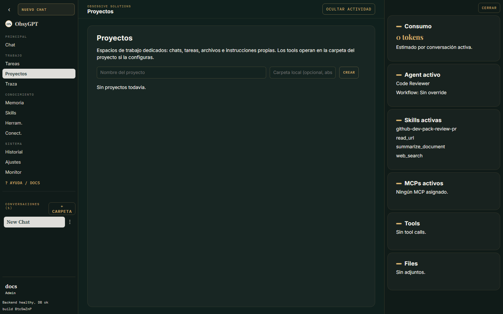
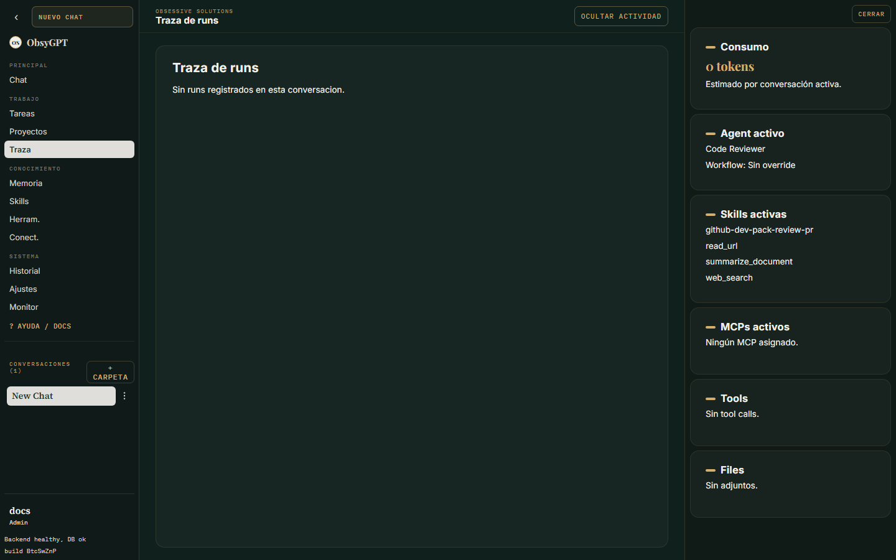
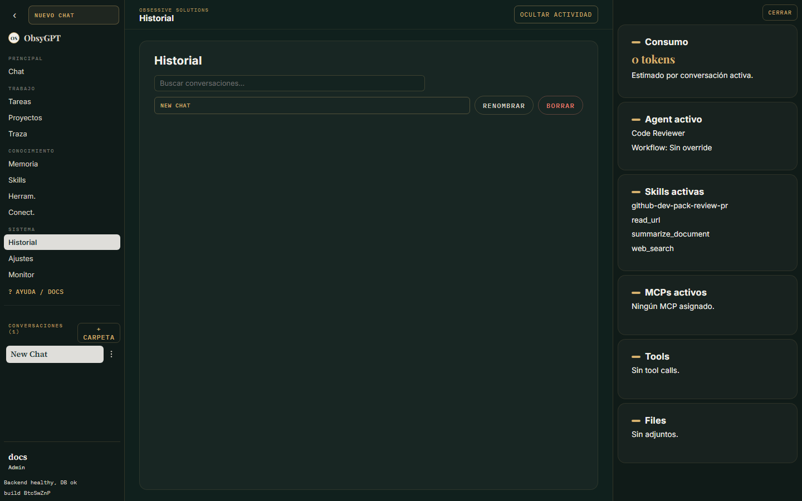

Empezar

# Recorrido visual

Una pantalla por sección: esto es lo que verás al entrar en ObsyGPT.

## Chat

El corazón de la app: conversaciones con tu agente activo, historial y carpetas en la barra lateral, selector de agente y modelo, modos **Act** / **Plan** / **Think** y paleta de skills (`Alt` + espacio).

- **Nuevo chat** desde la barra lateral; organiza conversaciones en carpetas.
- El **composer** acepta adjuntos y modo voz (micrófono push-to-talk).
- Cuando el agente intenta una acción sensible, aparece una **tarjeta de aprobación** con Aprobar / Rechazar.

## Tareas

Tareas en segundo plano del agente: programadas, recurrentes, pausables y cancelables. La insignia muestra cuántas están activas.

## Proyectos

Carpetas de proyecto con instrucciones, memoria, archivos y chats propios. Ideal para aislar contexto por cliente o iniciativa.

## Traza

Todo queda registrado: cada run, tool call, llamada MCP y aprobación es inspeccionable desde aquí, incluidos los runs hijos de sub-agentes.

## Memoria

Recuerdos por usuario que se inyectan en el chat, conversaciones indexadas semánticamente y sugerencias de hábitos aprendidos.

## Skills

Biblioteca de skills siguiendo el estándar Agent Skills (`SKILL.md`), editor integrado y generador con IA. Se invocan desde el chat con `/nombre_skill tarea`.

## Herramientas

Catálogo de tools disponibles y sus permisos (seguras vs. sensibles con aprobación).

## Conectores

Credenciales cifradas por usuario para GitHub (repos, archivos, issues) y Google Drive (solo lectura).

## Historial

Listado completo de conversaciones pasadas con filtros.

## Ajustes

Pestañas: Modelo, Preferencias, Seguridad, Sistema, Agentes, Triggers, Datos y Administración (solo admin), con buscador integrado.

## Monitorización (admin)

Métricas agregadas: runs/día, uso de tools, duraciones y fallbacks, con exportación OTLP opcional.

## Diagnóstico

Estado del sistema: salud de servicios, modelos activos y configuración efectiva.

