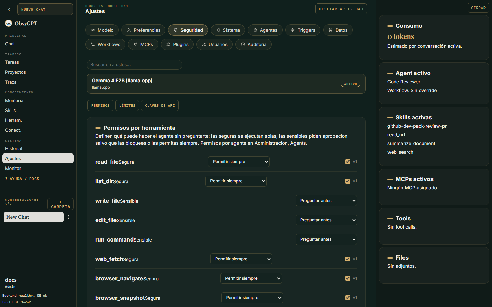

<p class="os-kicker" markdown>Operación</p>
# Seguridad

ObsyGPT está diseñado para correr en tu infraestructura con el mínimo de confianza posible en el agente: toda acción sensible pasa por ti, y los secretos nunca llegan al modelo.

## Secretos fuertes

- Cambia `POSTGRES_PASSWORD` y `SESSION_SECRET` antes de exponer la app.
- Con secretos por defecto el backend arranca pero emite un aviso **CRÍTICO** en el log: cookies de sesión y credenciales cifradas quedan desprotegidas.
- En producción usa `OBSYGPT_REQUIRE_STRONG_SECRETS=1`: el arranque **falla directamente** si `SESSION_SECRET` no está configurada.

```bash
python -c "import secrets; print(secrets.token_urlsafe())"
```

## Creación de cuentas

- La **primera cuenta** de una instancia nueva se crea libremente y es el **administrador** (bootstrap).
- A partir de ahí, **solo un administrador puede crear cuentas** — desde **Ajustes > Administración > Usuarios** (con rol usuario o admin). El registro público `/api/register` queda cerrado: un anónimo recibe 401 y un usuario sin rol admin recibe 403.
- El usuario creado aparece en la lista de usuarios, donde puedes cambiarle el rol en cualquier momento (siempre dejando al menos un admin).

## Permisos por herramienta

En **Ajustes > Seguridad > Permisos** defines por herramienta: *permitir*, *preguntar* (aprobación humana) o *bloquear*. Las escrituras de archivos, comandos de shell y sub-agentes son sensibles por defecto.



## Tool de shell

- Acotada a la carpeta del workspace.
- Hereda un entorno mínimo (sin API keys ni secretos del proceso) — usa `AGENT_COMMAND_ENV_PASSTHROUGH` para variables concretas.
- Cada segmento de comandos encadenados se valida contra `AGENT_COMMAND_ALLOWLIST`.

## Mitigación SSRF

`web_fetch`, `read_url` y la navegación del navegador **rechazan** URLs hacia localhost, IPs privadas y hosts que resuelvan a direcciones internas.

## Credenciales cifradas

- Conectores: credenciales por usuario cifradas con Fernet (`CONNECTOR_ENCRYPTION_KEY`, derivada de `SESSION_SECRET` si se omite); nunca se devuelven tras guardar.
- Telegram: tokens de bot cifrados en reposo; solo los IDs de la allowlist pueden usar cada bot.

## Auditoría

Todas las acciones administrativas quedan en **Ajustes > Administración > Auditoría** (con filtros por acción y tipo de objetivo), y los [runs de agentes](chat.md#traza-de-runs) en la vista Traza.

## Exposición OTLP (opcional)

Para observabilidad externa: `OTEL_EXPORTER_OTLP_ENDPOINT` / `OTEL_EXPORTER_OTLP_HEADERS`. El contenido de los eventos (`user_prompt`, `assistant_response`, `tool_result`, `api_error`) va **redactado por defecto** — controla la captura con `OTEL_CONTENT_CAPTURE`.
