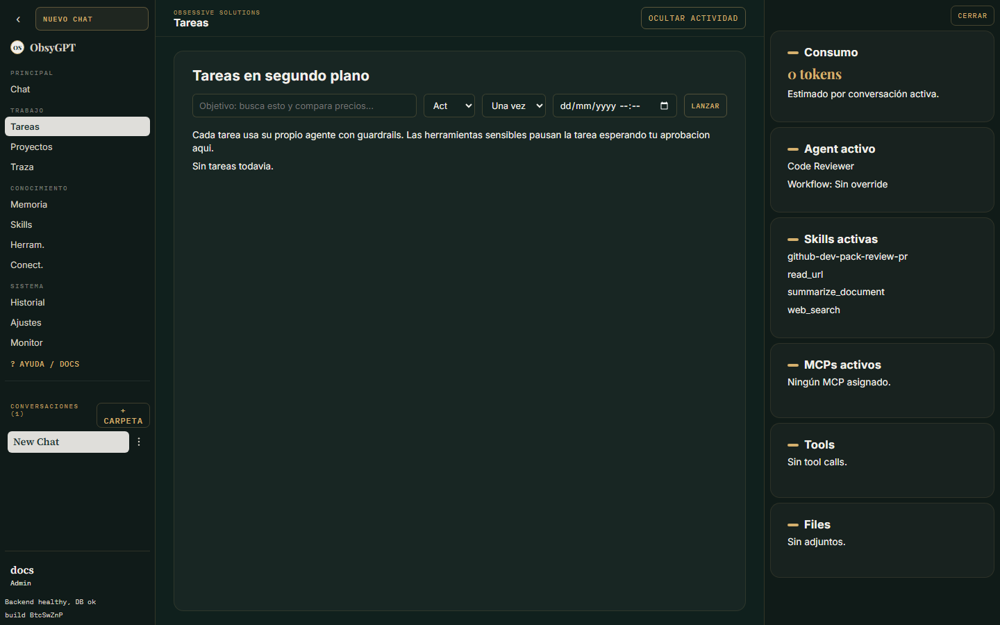

Trabajar

# Tareas

Las **tareas** son ejecuciones del agente en segundo plano: corren con sus tools, sus aprobaciones y sus trazas sin que tengas el chat abierto. La insignia de la barra lateral muestra cuántas están activas.

## Crear una tarea

En la vista **Tareas**, define el objetivo, el modo (act / plan), y opcionalmente:

- **Programación** — fecha y hora de arranque.
- **Recurrencia** — cada X minutos, horas o días.

## Ciclo de vida

1. **Pendiente** — espera su momento (si está programada).
2. **En ejecución** — el bucle agéntico trabaja en segundo plano.
3. **Pausada / Reanudada** — congela el run y retómalo después.
4. **Cancelada** — corta la ejecución.
5. **Completada** — con el resultado final visible en la tarjeta.

Si el backend se reinicia a mitad de una tarea, la **auto-recuperación** la retoma automáticamente.

## Aprobaciones dentro de una tarea

Cuando una tarea pausa por una [tool sensible](herramientas.md), la decisión aparece tanto en la UI como — si tienes el bot configurado — como **botones inline en Telegram**.

## Configuración

En **Ajustes > Sistema > Tareas**:

| Ajuste | Descripción |
|---|---|
| Tareas simultáneas máximas | Cuántas corren en paralelo (1-4) |
| Reanudar tareas automáticamente | Auto-recuperación tras reinicios |
