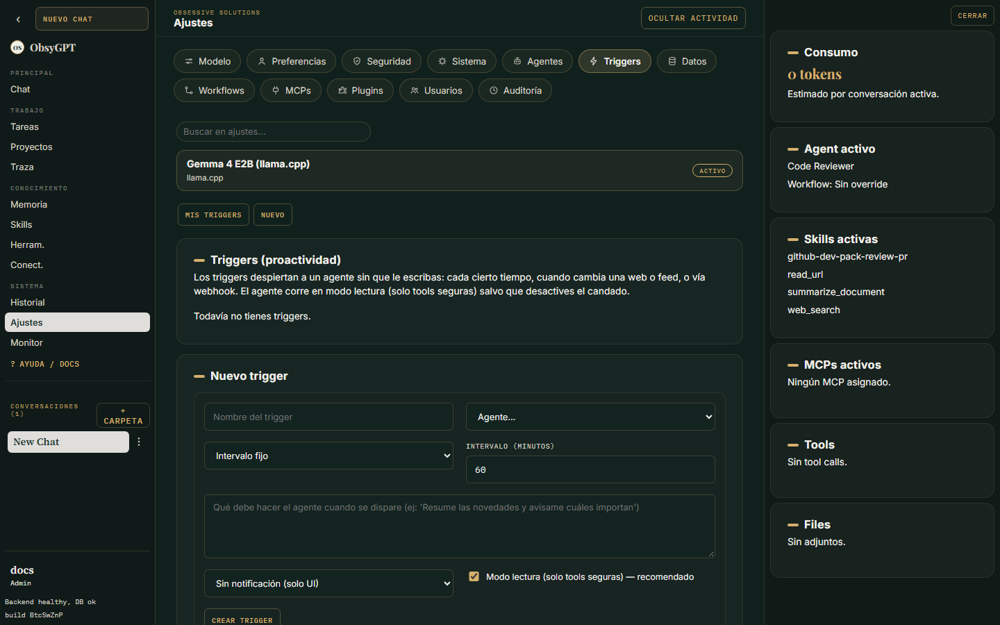

Automatizar

# Triggers proactivos

Los triggers **despiertan a tus agentes solos**, sin que escribas nada. Configúralos en **Ajustes > Triggers** (pestañas *Mis triggers* y *Nuevo*).

## Tipos de trigger

| Tipo | Qué hace | Ejemplo |
|---|---|---|
| **Intervalo fijo** | Despierta al agente cada N minutos | "Cada 60 minutos resume las novedades de IA" |
| **Vigilar cambio** | Compara un snapshot de una URL o feed RSS y dispara cuando cambia | "Avísame si sale algo nuevo en el blog X" |
| **Webhook** | Un sistema externo despierta al agente | n8n o GitHub llaman a `POST /api/triggers/{id}/fire` con el header `X-Trigger-Secret` |

## Modo lectura

Los runs disparados por triggers arrancan en **modo lectura**: solo tools seguras, sin sub-agentes. Puedes desactivar el candado trigger a trigger si confías en el agente para ese flujo.

## Auto-agendación

Los agentes pueden agendarse seguimientos a sí mismos con las tools:

- `schedule_trigger` — crea un trigger nuevo (con objetivo y tipo).
- `my_triggers` — lista los triggers propios.
- `cancel_trigger` — cancela uno.

Estas tools se habilitan por agente en **Ajustes > Agentes > Herramientas**. Hay un **máximo de 10 triggers activos por usuario**.

## Anti-ruido

- **Cooldown** por trigger: evita disparos repetidos en ráfaga.
- **Notificación por Telegram**: el trigger puede avisarte al terminar el run.
